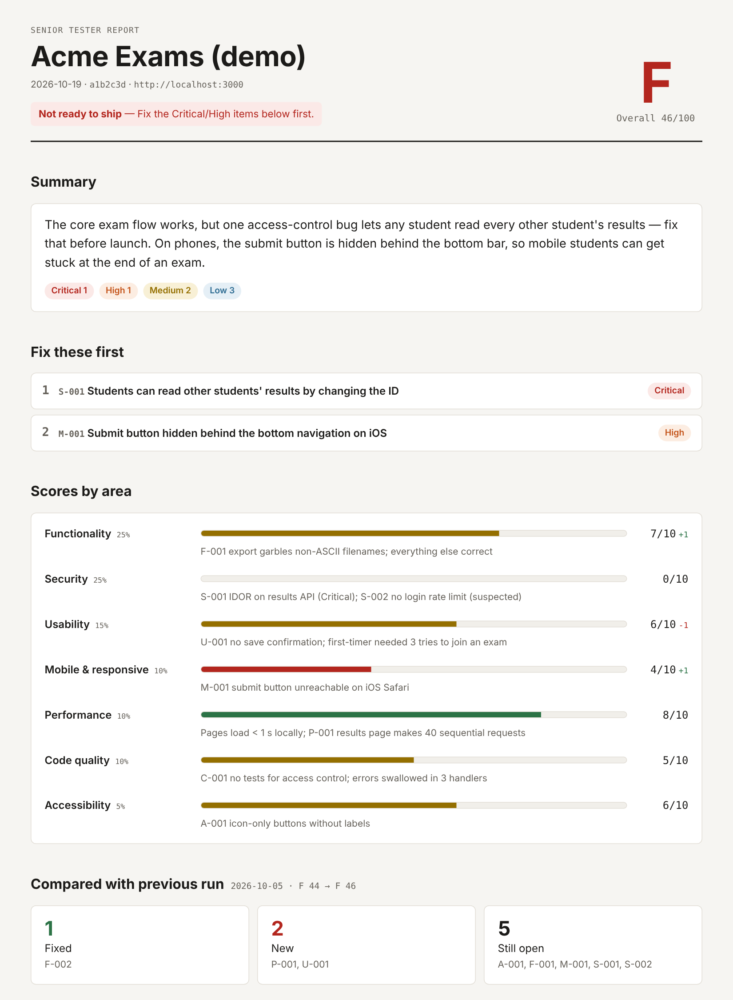

# senior-tester

**A senior QA engineer and security reviewer for your web app — as a Claude skill.**

Point it at your repo and your running app. It reads the code, uses the site the way real people do (a first-timer, someone on a phone, an admin, a curious attacker), checks security against OWASP Top 10, scores every area against a fixed rubric, and hands you **one HTML report** that says what's broken, where, how to reproduce it, how to fix it, and what to build next.

<p align="center">
  
</p>

> [Full example report](examples/qa-report.html) (download and open in a browser) · [Markdown version](examples/qa-report.md) · [SARIF](examples/qa-findings.sarif)

## Why

Solo developers and small teams rarely have a dedicated tester. Automated scanners find patterns but don't *use* your app; manual testing takes time you don't have. `senior-tester` gives you a structured, repeatable second opinion before every release:

- **Two angles at once.** Code review finds the bug's location; live testing proves it matters. The strongest findings have both.
- **Personas, not just checklists.** "The mobile user couldn't reach the submit button" is a finding a code scanner will never produce.
- **Evidence-first.** Every Critical/High finding needs reproduction steps and a location, or the report won't build. Unconfirmed issues are clearly labeled *suspected*.
- **Scores you can compare.** Fixed anchors and weights, grade caps for show-stoppers, and a run-to-run diff of what was fixed, what's new and what's still open.
- **Safe by design.** Non-destructive probes only, test accounts only, secrets are masked, production gets read-only checks.

## What you get

| Output | For |
|---|---|
| `qa-report.html` | The report. Self-contained, works offline, light/dark, mobile-friendly, printable to PDF |
| `findings.json` | Structured results. Keep it — the next run compares against it |
| `qa-report.md` | Paste into a pull request, issue or chat |
| `qa-findings.sarif` | Upload to GitHub code scanning to see findings inline in your code |

The report includes: ship/no-ship verdict · overall grade · top priorities · 7 scored areas · every finding with steps, evidence, screenshot and fix · persona journeys · security checklist · comparison with the previous run · next-step ideas ranked by impact ÷ effort.

## Install

### Claude Code (plugin)

```bash
claude plugin marketplace add phanupongm/senior-tester-report
claude plugin install senior-tester@senior-tester
```

Or inside a session: `/plugin marketplace add phanupongm/senior-tester-report`, then `/plugin install senior-tester@senior-tester`.

### Claude Code (skill only, no plugin)

```bash
git clone https://github.com/phanupongm/senior-tester-report.git
cp -r senior-tester-report/skills/senior-tester ~/.claude/skills/        # all your projects
# or: cp -r senior-tester-report/skills/senior-tester .claude/skills/      # this project only
```

### Claude.ai / Claude desktop app

1. Download `senior-tester-skill.zip` from the [latest release](../../releases/latest) (or zip the `skills/senior-tester` folder yourself).
2. Make sure code execution is enabled (Settings → Capabilities).
3. Go to **Customize → Skills → + → Create skill → Upload a skill** and upload the zip.

See [Use skills in Claude](https://support.claude.com/en/articles/12512180-use-skills-in-claude) for plan availability and details.

## Use

Just ask. For example:

```
Test my app before release. The code is this repo, it runs at http://localhost:3000,
test accounts are in prisma/seed.ts. Most important: sign up → create a project → invite a teammate.
```

```
/senior-tester:senior-tester . http://localhost:5173 quick
```

```
I fixed the issues from last time — retest using qa-work/findings.json
```

### Modes

| Mode | What it does | Use when |
|---|---|---|
| `full` *(default)* | Code review + live persona testing + security + report | Before a release |
| `code` | Code and dependencies only | The app isn't running |
| `live` | Black-box testing of the running app | You don't have the code |
| `quick` | Top journeys, 3 personas, the highest-risk security checks | Limited time |
| `retest` | Re-verifies every open finding from the last run, then a regression pass | After fixing |

### Requirements

- **Python 3.9+** (scripts use the standard library only — nothing to install)
- **For live testing:** a browser tool Claude can drive — e.g. [Playwright MCP](https://github.com/microsoft/playwright-mcp), Claude in Chrome, or the Claude desktop app's browser. Without one, the skill falls back to `code` mode and says so.
- Optional: your stack's dependency auditor (`npm audit`, `pip-audit`, `composer audit`, …)

## How it works

```
1 Scope ─► 2 Code recon ─► 3 Persona testing ─► 4 Security ─► 5 Score ─► 6 Ideas ─► 7 Report
            scan_repo.py      browser                 checklist     rubric                  build_report.py
```

1. **Scope** — repo, URL, test accounts, key journeys. Asks once; if you're away it states its assumptions and continues.
2. **Code recon** — `scan_repo.py` maps the stack, every route with an auth hint, risky patterns (raw SQL, HTML sinks, `eval`, disabled TLS…), masked possible secrets, `.env`/git hygiene, test and audit commands. Hits are leads that Claude confirms by reading the code. Stack-specific pitfalls for 12 stacks are in [`stack-playbooks.md`](skills/senior-tester/references/stack-playbooks.md).
3. **Persona testing** — First-timer, Mobile user and Intruder always; plus role and optional personas (power user, careless typer, low-vision user, international user…). Each stays in character and logs a journal.
4. **Security** — the OWASP Top 10 [checklist](skills/senior-tester/references/security-checklist.md) plus secrets and privacy, against both code and live app, with harmless probes only.
5. **Score** — 7 areas, fixed [anchors and weights](skills/senior-tester/references/scoring-rubric.md). An open Critical caps the grade at D; an open High security issue caps it at C.
6. **Ideas** — next steps tied to evidence from this run, ranked by impact ÷ effort.
7. **Report** — `build_report.py` validates `findings.json`, embeds screenshots, and writes HTML, Markdown and SARIF.

## Scoring at a glance

| Area | Weight |
|---|---|
| Functionality | 25 |
| Security | 25 |
| Usability | 15 |
| Mobile & responsive | 10 |
| Performance | 10 |
| Code quality | 10 |
| Accessibility | 5 |

Grade: A ≥ 90 · B ≥ 80 · C ≥ 70 · D ≥ 60 · F < 60 (before caps).

## Use the scripts on their own

Both scripts work without Claude:

```bash
# Map a codebase
python3 skills/senior-tester/scripts/scan_repo.py path/to/repo --out qa-work/recon

# Render a report from findings.json (HTML + optional Markdown and SARIF)
python3 skills/senior-tester/scripts/build_report.py findings.json qa-report.html \
  --shots qa-work/shots --previous old-findings.json --md qa-report.md --sarif qa-findings.sarif
```

The `findings.json` format is documented in [`findings-schema.md`](skills/senior-tester/references/findings-schema.md), with a JSON Schema in [`schema/findings.schema.json`](skills/senior-tester/schema/findings.schema.json).

### Upload findings to GitHub code scanning

```yaml
- uses: github/codeql-action/upload-sarif@v3
  with:
    sarif_file: qa-findings.sarif
    category: senior-tester
```

## Report languages

The report UI ships in **English** and **Thai** (`meta.language: "en" | "th"`). The findings themselves are written in whatever language you talk to Claude in. Adding a language is one dictionary in `build_report.py` — PRs welcome.

## Responsible use

Use this only on systems you own or have written permission to test. The skill refuses third-party targets, prefers local/staging environments, sticks to non-destructive probes, and never prints secrets in full. It is a strong second opinion, **not a substitute for a professional penetration test** on systems that handle money, health or other sensitive data. See [SECURITY.md](SECURITY.md).

## Repository layout

```
.claude-plugin/          plugin.json + marketplace.json (Claude Code)
skills/senior-tester/
  SKILL.md               the workflow Claude follows
  references/            personas, security checklist, rubric, schema, stack playbooks
  scripts/               scan_repo.py, build_report.py (stdlib only)
  assets/                report template
  schema/                findings JSON Schema
examples/                sample findings, previous run, and generated outputs
tests/                   unit tests (python -m unittest)
```

## Contributing

Issues and PRs are welcome — especially new stack playbooks, scanner patterns with test cases, persona ideas, and report translations. See [CONTRIBUTING.md](CONTRIBUTING.md).

## License

[MIT](LICENSE)
